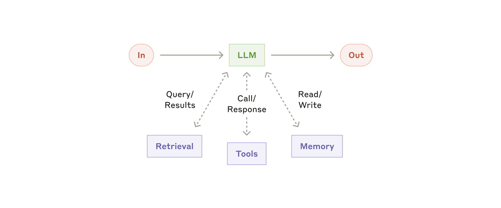
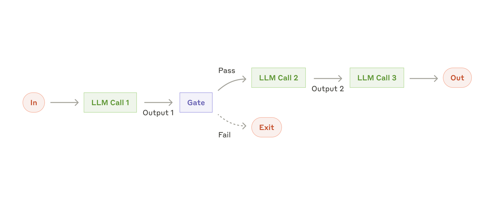
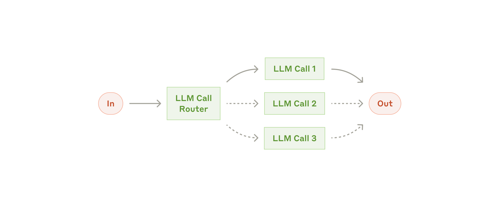
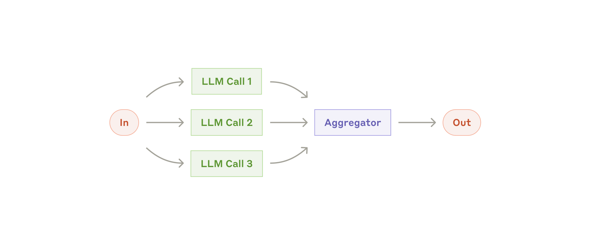
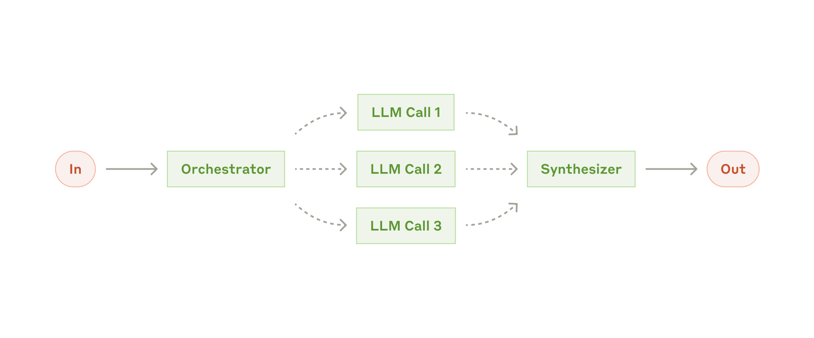
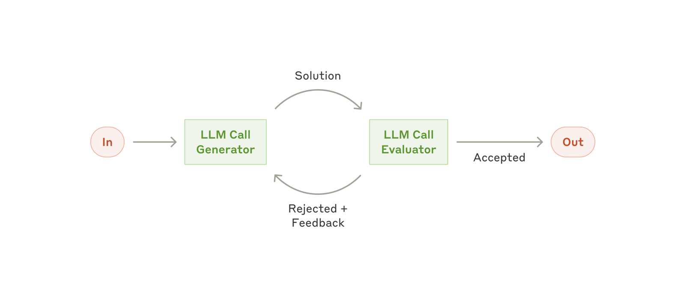
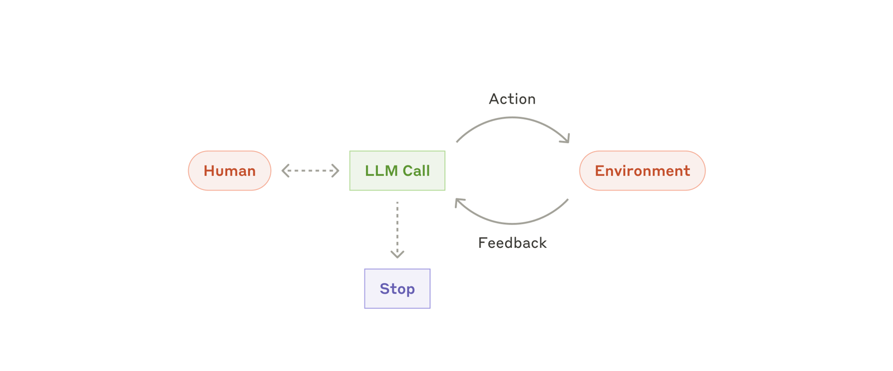
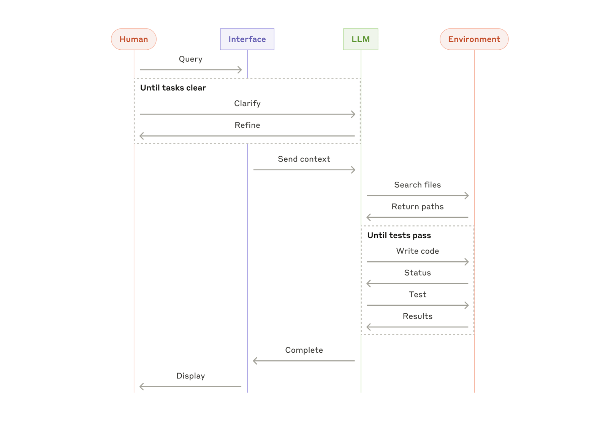

> **译文说明**
>
> - 原文：[Building effective AI agents](https://www.anthropic.com/research/building-effective-agents)，Anthropic 官方研究博客，2024 年 12 月发布。
> - 本文为全文翻译，配图已转存至本站，避免外链失效。正文内容忠实于原文，不增删观点。
> - 文中以「**译注**」开头的段落为译者补充，不属于原文内容，已明确区分。
> - 原文中的模型名称（如 Claude Haiku 4.5、Claude Sonnet 4.5）为原文表述，照实翻译，未作改写。
> - 术语对照：agentic systems → 智能体系统；workflows → 工作流；agents → 智能体；augmented LLM → 增强型 LLM；prompt chaining → 提示词链；routing → 路由；parallelization → 并行化；orchestrator-workers → 编排器-工作者；evaluator-optimizer → 评估器-优化器；ACI（agent-computer interface）→ 智能体-计算机接口。

> **译注：原文的开篇更新提示**
>
> 原文顶部现有一条注记，说明「本文描述的许多工具生态自 2024 年 12 月起已经发生变化」，并指向 Anthropic 当前的做法（Claude Managed Agents 及其文档）。该注记是原文后续追加的，本文保留于此，正文仍按 2024 年 12 月原版翻译。阅读时请注意：**文中提到的具体工具与框架清单可能已过时，但其中关于架构模式的判断至今仍然适用。**

## 一、什么是智能体？

过去一年里，我们与数十个跨行业的团队合作构建大语言模型（LLM）智能体。一个稳定的规律是：**最成功的实现并没有使用复杂的框架或专门的库，而是用简单、可组合的模式构建出来的。**

本文分享我们从客户合作与自研智能体中得到的经验，并为开发者提供构建高效智能体的实用建议。

### 什么是智能体

"智能体"（Agent）有若干种定义方式。有些客户把智能体定义为完全自主的系统：能在较长时间内独立运行，使用各种工具完成复杂任务。另一些客户则用这个词描述更循规蹈矩的实现——遵循预定义工作流的系统。

在 Anthropic，我们把所有这些变体统称为**智能体系统（agentic systems）**，但在架构上对**工作流**与**智能体**作了重要区分：

- **工作流（Workflows）** 是指大语言模型和工具通过**预定义的代码路径**被编排的系统。
- **智能体（Agents）** 则是指大语言模型**动态地自行决定**其流程与工具使用、并对如何完成任务保持控制权的系统。

下文将详细探讨这两类智能体系统。在附录 1（"智能体的实践"）中，我们描述了客户认为特别有价值的两个领域。

## 二、何时使用（以及何时不使用）智能体

用大语言模型构建应用时，我们建议**先从最简单的方案入手，只在确有必要时才增加复杂度**。这可能意味着根本不构建智能体系统。

智能体系统通常以延迟和成本为代价换取更好的任务表现，你需要判断这种权衡在你的场景中是否成立。

当确实需要更高复杂度时：**工作流**为定义明确的任务提供可预测性和一致性；而**智能体**则更适合需要灵活性、且要在大规模下由模型驱动决策的场景。

不过对许多应用来说，**用检索和上下文示例来优化单次 LLM 调用通常就已经足够**。

## 三、何时以及如何使用框架

有许多框架能让智能体系统更易实现，包括：

- [Claude Agent SDK](https://platform.claude.com/docs/en/agent-sdk/overview)
- [Strands Agents SDK（AWS）](https://strandsagents.com/latest/)
- [Rivet](https://rivet.ironcladapp.com/)：一个拖拽式的图形化 LLM 工作流构建器
- [Vellum](https://www.vellum.ai/)：另一个用于构建和测试复杂工作流的图形化工具

这些框架通过简化标准底层任务（调用 LLM、定义与解析工具、串联调用）让上手变得容易。但**它们往往会引入额外的抽象层，遮蔽底层的提示词与响应，使调试更困难**。它们也容易诱导你在简单方案已经足够时去增加复杂度。

我们建议开发者**从直接使用 LLM API 开始**：许多模式只需几行代码就能实现。如果你确实要使用框架，请确保你理解其底层代码——**对底层机制的错误假设，是客户出错的常见来源**。

示例实现可参见我们的 [cookbook](https://platform.claude.com/cookbook/patterns-agents-basic-workflows)。

## 四、构建块、工作流与智能体

本节探讨我们在生产环境中见到的智能体系统常见模式。我们从基础构建块——**增强型 LLM**——开始，逐步提升复杂度，从简单的可组合工作流一直到自主智能体。

### 构建块：增强型 LLM

智能体系统的基本构建块，是一个通过**检索、工具、记忆**等增强手段强化过的 LLM。我们当前的模型能够主动使用这些能力——生成自己的搜索查询、选择合适的工具、并判断要保留哪些信息。

**增强型 LLM**

关于具体实现，我们建议重点关注两个方面：**把这些能力裁剪适配到你的具体用例**，以及**确保它们为 LLM 提供了易于使用、文档完善的接口**。

实现这些增强的方式有很多，其中一种是通过我们最近发布的 [Model Context Protocol](https://www.anthropic.com/news/model-context-protocol)——它让开发者可以用简单的[客户端实现](https://modelcontextprotocol.io/tutorials/building-a-client#building-mcp-clients)接入不断壮大的第三方工具生态。

下文假定每次 LLM 调用都能访问这些增强能力。

### 工作流：提示词链（Prompt chaining）

提示词链把任务分解为一系列步骤，每次 LLM 调用处理上一次调用的输出。你可以在任意中间步骤上加入**程序化检查**（见下图中的"闸门"），以确保流程仍在正轨上。

**提示词链工作流**

**何时使用此工作流**：当任务能够被轻松、干净地分解为固定的子任务时，此工作流最为理想。它的主要目标是用**延迟换取更高的准确率**——让每次 LLM 调用都成为一个更简单的任务。

**适用示例**：

- 先生成营销文案，再把它翻译成另一种语言。
- 先写出文档大纲，检查大纲是否满足特定标准，再基于大纲撰写文档。

### 工作流：路由（Routing）

路由对输入进行分类，并将其导向一个专门化的后续任务。这个工作流实现了**关注点分离**，并能构建更专门的提示词。如果没有它，针对某一类输入做的优化可能会损害其他输入上的表现。

**路由工作流**

**何时使用此工作流**：对于存在明显类别、且这些类别分开处理效果更好的复杂任务，路由表现良好——前提是分类能够被准确完成，这可以由 LLM 或更传统的分类模型/算法来完成。

**适用示例**：

- 把不同类型的客服问题（一般咨询、退款请求、技术支持）导向不同的下游流程、提示词和工具。
- 把简单/常见的问题路由到更小、更经济的模型（如 Claude Haiku 4.5），把困难/罕见的问题路由到能力更强的模型（如 Claude Sonnet 4.5），以取得最佳性能。

### 工作流：并行化（Parallelization）

LLM 有时可以同时处理一个任务，并通过程序化方式聚合它们的输出。这个工作流称为并行化，有两种主要变体：

- **分段（Sectioning）**：把任务拆成相互独立的子任务并行运行。
- **投票（Voting）**：对同一任务运行多次，以获得多样化的输出。

**并行化工作流**

**何时使用此工作流**：当拆分的子任务可以并行以提升速度，或需要多个视角/多次尝试以得到置信度更高的结果时，并行化是有效的。对于需要考虑多个方面的复杂任务，**让每一项考量由单独的 LLM 调用处理，通常表现更好**——这样可以让注意力聚焦在每一个具体方面。

**适用示例**：

- **分段**：
    - 实现护栏（guardrails）：一个模型实例处理用户查询，另一个实例筛查其中的不当内容或请求。这通常比让同一次 LLM 调用同时承担护栏和核心响应表现更好。
    - 自动化评估：每次 LLM 调用评估模型在给定提示词上某一方面的表现。
- **投票**：
    - 审查一段代码的漏洞：用多个不同的提示词分别审查，发现问题就标记出来。
    - 判断某段内容是否不当：用多个提示词评估不同方面，或要求不同的投票阈值，以平衡误报与漏报。

### 工作流：编排器-工作者（Orchestrator-workers）

在编排器-工作者工作流中，一个中心 LLM 动态地分解任务、将它们委派给工作者 LLM，并综合它们的结果。

**编排器-工作者工作流**

**何时使用此工作流**：此工作流非常适合那些**无法预知所需子任务**的复杂任务（例如在编码场景中，需要修改多少个文件、每个文件的改动性质，很可能取决于具体任务）。它与并行化在拓扑上相似，**关键区别在于灵活性**——子任务不是预先定义的，而是由编排器根据具体输入决定的。

**适用示例**：

- 每次都要对多个文件做复杂改动的编码产品。
- 需要从多个来源收集和分析信息、以寻找可能相关内容的搜索任务。

### 工作流：评估器-优化器（Evaluator-optimizer）

在评估器-优化器工作流中，一次 LLM 调用生成响应，另一次提供评估与反馈，二者构成循环。

**评估器-优化器工作流**

**何时使用此工作流**：当我们有**明确的评估标准**、且**迭代改进能带来可衡量的价值**时，此工作流尤其有效。契合的两个标志是：第一，当人类明确表达反馈时，LLM 的响应能被明显改进；第二，LLM 能够提供这样的反馈。这类似于人类作者在打磨文稿时所经历的迭代写作过程。

**适用示例**：

- 文学翻译：其中有些细微之处译者 LLM 起初可能捕捉不到，而评估器 LLM 能给出有用的批评。
- 需要多轮搜索与分析才能收集全面信息的复杂搜索任务：由评估器判断是否需要继续搜索。

### 智能体（Agents）

随着 LLM 在关键能力上日趋成熟——理解复杂输入、进行推理与规划、可靠地使用工具、以及从错误中恢复——智能体正在生产环境中涌现。

智能体以人类用户给出的指令或与用户的交互式讨论开始工作。**一旦任务明确，智能体便独立地规划与运行**，必要时可能回到人类那里获取更多信息或判断。在执行过程中，**智能体在每一步从环境中获取"真实依据"（ground truth，例如工具调用结果或代码执行结果）来评估进展**，这一点至关重要。智能体随后可以在检查点、或遇到阻塞时暂停以获取人类反馈。任务通常在完成时终止，但**加入停止条件（例如最大迭代次数）以保持控制**也很常见。

智能体能处理复杂的任务，但它们的实现往往很直接。**它们通常只是一个在循环中根据环境反馈使用工具的 LLM。** 因此，清晰地、深思熟虑地设计工具集及其文档至关重要。我们在附录 2（"为你的工具做提示词工程"）中详述了工具开发的最佳实践。

**自主智能体**

**何时使用智能体**：智能体可用于**开放式问题**——那些难以或无法预测所需步骤数、且无法硬编码固定路径的场景。LLM 可能会运行许多轮，你必须对其决策有一定程度的信任。**智能体的自主性使其非常适合在可信环境中扩展任务。**

智能体的自主特性意味着**更高的成本，以及错误可能不断累积的风险**。我们建议在沙箱环境中进行充分测试，并配备恰当的护栏。

**适用示例**（以下示例来自我们自己的实现）：

- 用于解决 [SWE-bench 任务](https://www.anthropic.com/research/swe-bench-sonnet)的编码智能体：这类任务需要根据任务描述修改多个文件。
- 我们的 ["computer use" 参考实现](https://github.com/anthropics/anthropic-quickstarts/tree/main/computer-use-demo)：Claude 使用一台计算机来完成任务。

**编码智能体的高层流程**

## 五、组合与定制这些模式

这些构建块**并非规定性的**。它们只是常见模式，开发者可以自行塑造与组合，以适应不同的用例。

与所有 LLM 特性一样，成功的关键在于**衡量表现并迭代实现**。再重复一次：**只有在能够明确证明结果有所改善时，才考虑增加复杂度。**

## 六、总结

在 LLM 领域取得成功，靠的不是构建最复杂的系统，而是**构建适合你需求的系统**。

从简单的提示词开始，用全面的评估来优化它们，**只有当更简单的方案无法胜任时**，才引入多步骤的智能体系统。

在实现智能体时，我们尝试遵循三条核心原则：

1. 在智能体设计中保持**简洁**（simplicity）。
2. 通过显式展示智能体的规划步骤来优先保证**透明**（transparency）。
3. 通过充分的工具**文档与测试**，精心打造你的智能体-计算机接口（ACI）。

框架能帮你快速上手，但走向生产时**不要犹豫去削减抽象层，用基础组件来构建**。遵循这些原则，你就能构建出不仅强大、而且可靠、可维护、并为用户所信任的智能体。

## 附录 1：智能体的实践

我们与客户的合作揭示了两类特别有前景的智能体应用，它们印证了上述模式的实用价值。这两个应用都说明了智能体在什么样的任务中最能增值：**既需要对话又需要行动、有明确的成功标准、能形成反馈回路、并融入了有意义的人类监督**。

### A. 客户支持

客户支持把熟悉的聊天机器人界面与通过工具集成带来的增强能力结合起来。这天然适合更开放式的智能体，因为：

- 支持交互天然遵循对话流程，同时需要访问外部信息和执行操作；
- 可以集成工具来调取客户数据、订单历史与知识库文章；
- 发放退款、更新工单等操作可以通过程序化方式处理；
- 成功与否可以通过用户自定义的解决方案（resolution）清晰衡量。

已有若干公司通过**按成功解决的次数计费**的用量定价模式，证明了这一路径的可行性——这体现了它们对自家智能体效果的信心。

### B. 编码智能体

软件开发领域已显现出 LLM 特性的显著潜力，其能力正从代码补全演进到自主解决问题。智能体在此尤其有效，因为：

- 代码方案可以通过自动化测试验证；
- 智能体可以利用测试结果作为反馈来迭代方案；
- 问题空间定义良好、结构清晰；
- 输出质量可以被客观衡量。

在我们自己的实现中，智能体现在能够仅凭 pull request 的描述，在 [SWE-bench Verified](https://www.anthropic.com/research/swe-bench-sonnet) 基准上解决真实的 GitHub issue。不过，尽管自动化测试有助于验证功能，**人工审查对于确保方案符合更广泛的系统要求仍然至关重要**。

## 附录 2：为你的工具做提示词工程

无论你构建哪种智能体系统，工具都很可能是其中的重要组成部分。工具让 Claude 能够与外部服务和 API 交互，方式是在我们的 API 中精确指定其结构与定义。当 Claude 计划调用某个工具时，它会在 API 响应中包含一个工具调用块（tool use block）。

**工具的定义与规格，应当获得与你整体提示词同等程度的提示词工程投入。** 在这个简短的附录中，我们介绍如何为工具做提示词工程。

同一个动作往往有多种指定方式。例如，你可以用**写 diff** 的方式指定文件编辑，也可以**重写整个文件**。对于结构化输出，你可以在 markdown 里返回代码，也可以在 JSON 里返回代码。在软件工程中，这类差异只是形式上的，可以无损地相互转换。然而，**某些格式对 LLM 来说比其他格式难写得多**：写 diff 需要在写出新代码之前就知道 chunk header 里有多少行在变化；在 JSON 里写代码（相比 markdown）需要对换行和引号做额外的转义。

关于如何决定工具格式，我们的建议是：

- 给模型足够的 token 用于"思考"，以免它把自己逼进死角。
- 让格式贴近模型在互联网文本中自然见过的形态。
- 确保没有格式上的"额外开销"，例如必须精确统计数千行代码，或需要为所写的任何代码做字符串转义。

一个经验法则是：想一想人机接口（HCI）上投入了多少精力，然后**计划在打造良好的智能体-计算机接口（ACI）上投入同样多的精力**。以下是具体做法的一些思路：

- **设身处地站在模型的角度想**：仅凭描述和参数，这个工具该怎么用是否一目了然？还是说要费一番思量？如果是后者，那对模型来说大概也是如此。一个好的工具定义通常包含使用示例、边界情况、输入格式要求，以及与其他工具的清晰界限。
- **如何改动参数名或描述能让它更明确？** 把这想成是在为你团队里的初级开发者写一份出色的 docstring。当你使用许多相似工具时，这一点尤其重要。
- **测试模型如何使用你的工具**：在我们的 [workbench](https://console.anthropic.com/workbench) 中跑大量示例输入，观察模型会犯什么错，并据此迭代。
- 对工具做 **[防错设计](https://en.wikipedia.org/wiki/Poka-yoke)（poka-yoke）**：调整参数，让犯错变得更难。

在构建我们用于 [SWE-bench](https://www.anthropic.com/research/swe-bench-sonnet) 的智能体时，**我们在优化工具上花的时间实际上比在整体提示词上更多**。例如，我们发现当智能体移出根目录后，模型在使用相对路径的工具时容易出错。为解决这一点，我们把工具改成**始终要求绝对路径**——结果模型使用这种方法时表现得毫无差错。
