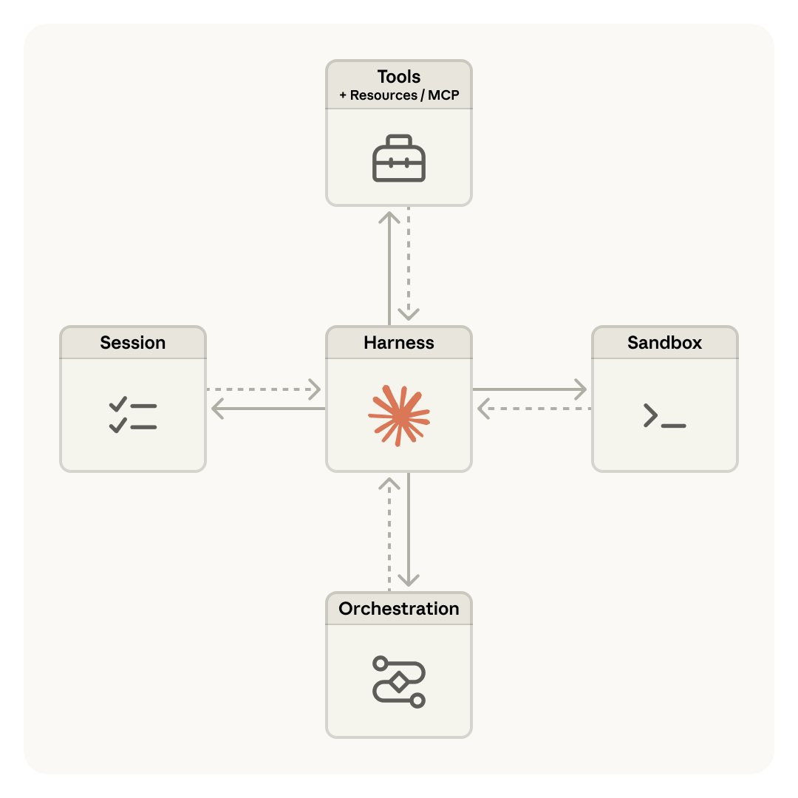
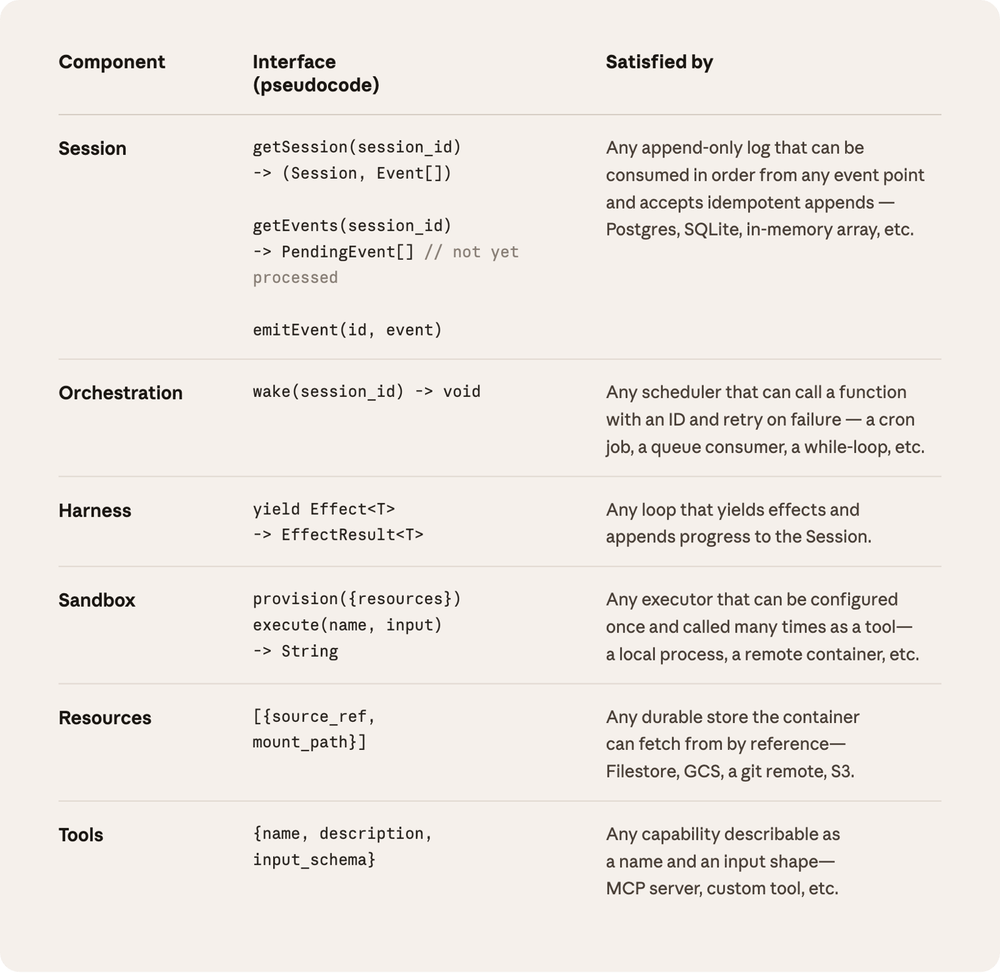
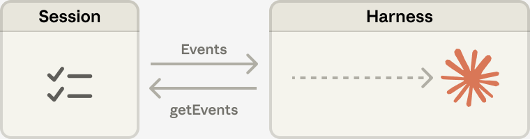
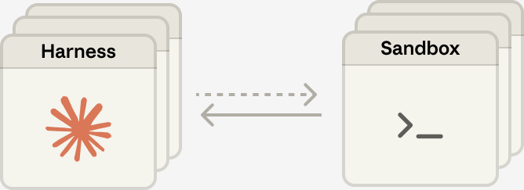

> **译文说明**
>
> - 原文：[Scaling Managed Agents with stable interfaces](https://www.anthropic.com/research/managed-agents)，Anthropic 官方研究博客。
> - 本文为全文翻译，配图已转存至本站，避免外链失效。正文内容忠实于原文，不增删观点。
> - 文中以「**译注**」开头的段落为译者补充，不属于原文内容，已明确区分。
> - 原文中的模型名称（如 Claude Sonnet 4.5、Claude Opus 4.5）、接口签名、性能数字均为原文表述，照实翻译。
> - 术语对照：harness → 运行框架（负责调用模型、路由工具调用的循环结构）；session → 会话；sandbox → 沙箱；brain → 大脑；hands → 手；pet / cattle → 宠物 / 牲畜；TTFT（time-to-first-token）→ 首 Token 延迟；meta-harness → 元框架；VPC → 虚拟私有云。
>
> **译注：关于标题与定位**
>
> 这篇是前一篇 [构建高效的 AI 智能体](./构建高效的AI智能体.md) 的后续与转向。前篇讲**模式**（工作流与智能体的设计范式），本篇讲**基础设施**——如何把这些模式承载在一个既能长期运行、又不会被未来的模型迭代拖垮的托管服务上。两者合起来才构成 Anthropic 对「Agent 怎么落地」的完整表述。

## 一、引言：运行框架里的假设会过时

> 想开始使用 Claude 托管智能体（Claude Managed Agents），请参阅我们的[文档](https://platform.claude.com/docs/en/managed-agents/overview)。

工程博客上有一个持续讨论的话题：如何[构建高效的智能体](https://www.anthropic.com/engineering/building-effective-agents)，以及如何为[长时间运行的工作](https://www.anthropic.com/engineering/harness-design-long-running-apps)设计[运行框架（harness）](https://www.anthropic.com/engineering/effective-harnesses-for-long-running-agents)。

贯穿这些工作的一个共同点是：**运行框架中编码了关于「Claude 靠自己能做什么、不能做什么」的假设**。然而，这些假设需要被不断质疑，因为随着模型能力提升，它们会[过时](http://www.incompleteideas.net/IncIdeas/BitterLesson.html)。

举一个例子。在先前的工作中我们[发现](https://www.anthropic.com/engineering/harness-design-long-running-apps)，Claude Sonnet 4.5 会在感觉到上下文上限临近时草草收尾——这种行为有时被称为「上下文焦虑」（context anxiety）。我们在运行框架里加入了**上下文重置**来解决它。但当我们把同一套运行框架用在 Claude Opus 4.5 上时，发现这个行为消失了。那些重置变成了累赘。

我们预计运行框架会持续演进。所以我们构建了 Managed Agents：这是 Claude 平台中的一项托管服务，通过一小组**意在比任何具体实现都更长寿**的接口，替你运行长时间跨度的智能体——这「任何具体实现」也包括我们今天自己跑的那一套。

构建 Managed Agents 意味着要解决计算机领域的一个老问题：如何为一个「[尚未被想到的程序](http://www.catb.org/esr/writings/taoup/html/ch03s01.html)」设计系统。

几十年前，操作系统通过把硬件虚拟化成抽象——**进程、文件**——解决了这个问题。这些抽象足够通用，能容纳当时还不存在的程序。**抽象比硬件活得更久。** `read()` 命令并不关心它访问的是 1970 年代的磁盘组还是现代的 SSD。上层的抽象保持稳定，下层的实现则可以自由更换。

Managed Agents 遵循同样的模式。我们虚拟化了智能体的各个组件：

| 组件 | 原文定义 | 职责 |
| --- | --- | --- |
| **会话（session）** | 所有发生过的事情的**只追加日志**（append-only log） | 持久记录，不依赖任何进程存活 |
| **运行框架（harness）** | 调用 Claude、并把 Claude 的工具调用路由到相应基础设施的**循环** | 无状态，可随时重启 |
| **沙箱（sandbox）** | Claude 可以在此运行代码、编辑文件的**执行环境** | 可替换，失败即丢弃重建 |

这样一来，每个组件的实现都可以在不打扰其他组件的情况下被替换。**我们对这些接口的形状有明确主张，但对它们背后运行什么没有主张。**



## 二、不要养宠物

我们最初把所有智能体组件放进**同一个容器**，也就是会话、运行框架、沙箱三者共享一个环境。这种做法有好处：文件编辑是直接的系统调用，也不存在需要设计的服务边界。

但把一切都耦合进一个容器后，我们撞上了一个老的基础设施问题：**我们养了一只宠物**。

在「[宠物 vs 牲畜](https://cloudscaling.com/blog/cloud-computing/the-history-of-pets-vs-cattle/)」的类比中，**宠物**是有名字、需要手工照料、你损失不起的个体；而**牲畜**是可以互换的。在我们的情形里，服务器成了那只宠物——如果某个容器挂了，会话就丢了；如果某个容器无响应，我们得小心翼翼地把它照料回健康状态。

> **译注**：「pets vs cattle」是云原生领域的经典隐喻，用来区分「需要人工维护的具名单机」和「可随意替换的同质实例」。追求后者的架构才能规模化。

照料容器意味着要调试无响应的卡死会话。我们唯一的观测窗口是 WebSocket 事件流，但它无法告诉我们失败**发生在哪里**——这意味着：运行框架里的 bug、事件流中的丢包、容器掉线，三者呈现出来的现象完全一样。

要弄清到底出了什么问题，工程师得在容器里打开一个 shell；但那个容器往往同时存放着用户数据，所以这个办法实际上等于**我们没有调试能力**。

第二个问题是：运行框架假定「Claude 工作所针对的东西就住在同一个容器里」。当客户要求我们把 Claude 接入他们的虚拟私有云（VPC）时，他们要么得把自己的网络与我们的对等互联，要么得在自己的环境里跑我们的运行框架。**一个被烤进运行框架的假设，在我们想把它接到不同基础设施上时就变成了障碍。**

## 三、把大脑与手解耦

我们最终得到的方案，是把我们心目中的「**大脑**」（Claude 及其运行框架）从两样东西里解耦出来：「**手**」（执行动作的沙箱与工具）和「**会话**」（会话事件日志）。

三者各自成为一个**对彼此做极少假设**的接口，也各自可以独立地失败或被替换。

### 运行框架离开容器

把大脑与手解耦，意味着运行框架不再住在容器里面。它像调用任何其他工具那样调用容器：

```text
execute(name, input) → string
```

容器变成了牲畜。如果容器死了，运行框架把这个失败当作一次工具调用错误捕获下来，并回传给 Claude。如果 Claude 决定重试，一个新容器可以按标准配方重新初始化：

```text
provision({resources})
```

我们再也不必把失败的容器照料回健康状态了。

### 从运行框架故障中恢复

运行框架也变成了牲畜。**因为会话日志位于运行框架之外，运行框架里没有任何东西需要挺过一次崩溃。**

当一个运行框架挂掉时，新的实例可以这样启动：用 `wake(sessionId)` 唤醒它，用 `getSession(id)` 取回事件日志，然后从最后一个事件处继续。在智能体循环运行期间，运行框架通过 `emitEvent(id, event)` 写入会话，以此保留一份持久的事件记录。



### 安全边界

在耦合式设计中，Claude 生成的任何不可信代码都与**凭证**跑在同一个容器里——于是**一次提示注入只需要说服 Claude 读取它自己的环境**就够了。一旦攻击者拿到那些令牌，他们就能派生全新的、不受限制的会话，并把工作委派给它们。

收窄作用域是一种显而易见的缓解，但**这等于编码了一个「Claude 拿着受限令牌做不了什么」的假设——而 Claude 正变得越来越聪明。**

结构性的修法是：确保**令牌永远不会从沙箱内部可达**，因为 Claude 生成的代码就跑在沙箱里。

我们用了两种模式来保证这一点：**凭证可以随资源一起捆绑，也可以存放在沙箱之外的保险库（vault）中。**

- **对 Git**：我们在沙箱初始化时，用每个仓库自己的访问令牌克隆仓库，并把它接线到本地 git remote。于是 `git push` 和 `git pull` 都能在沙箱内部工作，**而智能体全程无需自己处理令牌**。
- **对自定义工具**：我们支持 MCP，并把 OAuth 令牌存放在安全保险库中。Claude 通过一个**专用代理**调用 MCP 工具；这个代理接收与会话关联的令牌，然后从保险库取出对应凭证，再发起对外部服务的调用。**运行框架自始至终都不会接触到任何凭证。**

## 四、会话不是 Claude 的上下文窗口

长时间跨度的任务往往会超出 Claude 上下文窗口的长度，而应对这个问题的标准做法，都涉及「**保留什么**」的**不可逆决策**。我们在先前关于[上下文工程](https://www.anthropic.com/engineering/effective-context-engineering-for-ai-agents)的工作中探讨过这些技术。例如：

- **压缩（compaction）**：让 Claude 为它的上下文窗口保存一份摘要；
- **记忆工具（memory tool）**：让 Claude 把上下文写入文件，从而实现跨会话的学习；
- 这些可以与**上下文裁剪（context trimming）**配合使用，有选择地移除旧工具结果或思考块之类的 Token。

但「有选择地保留或丢弃上下文」这类不可逆决策会导致失败。**很难预知未来的轮次会需要哪些 Token。** 如果消息被压缩步骤变换过，运行框架会把被压缩的消息从 Claude 的上下文窗口中移除，而这些消息**只有在被存储下来的前提下**才能恢复。

先前的工作[探索过](https://arxiv.org/pdf/2512.24601)应对之道：把上下文存成一个**活在上下文窗口之外**的对象。例如，上下文可以是 REPL 中的一个对象，大模型通过编写代码以编程方式访问它、对它做过滤或切片。



在 Managed Agents 中，**会话提供的正是这一好处**：它充当一个位于 Claude 上下文窗口之外、可持久存储的上下文对象。但与把上下文存在沙箱或 REPL 中不同，**上下文被持久地存放在会话日志里**。

接口 `getEvents()` 让大脑可以通过选取事件流的位置切片来质询上下文。这个接口可以被灵活使用：让大脑从它上次停止阅读的地方接着读、在某个特定时刻之前回退几个事件看看前因，或者在某次特定动作之前重读上下文。

任何取回的事件，还可以在进入 Claude 的上下文窗口之前**在运行框架中被变换**。这些变换可以是运行框架所编码的任何内容，包括为了达成高提示词缓存命中率而做的上下文组织，以及上下文工程。

我们把「**可恢复的上下文存储**（在会话中）」与「**任意的上下文管理**（在运行框架中）」这两个关注点分开，是因为**我们无法预知未来的模型会需要什么样的具体上下文工程**。这些接口把上下文管理推给运行框架，**只保证会话是持久的、且可被质询**。

## 五、多个大脑，多双手

### 多个大脑

把大脑与手解耦，解决了我们最早的客户抱怨之一。当团队希望 Claude 在他们自己的 VPC 里对资源工作时，唯一的路径是把他们的网络与我们对等互联——因为承载运行框架的容器假定**每个资源都在它旁边**。一旦运行框架不再在容器里，这个假设就消失了。

同一个改动还带来了**性能上的回报**。当我们最初把大脑放进容器时，意味着**多个大脑需要多个容器**。对每个大脑而言，在容器被准备好之前，推理根本无法开始；每个会话都要在开头支付完整的容器启动成本——**每个会话都要克隆仓库、启动进程、从我们的服务器拉取待处理事件，哪怕这个会话永远不会碰沙箱。**

这段死时间体现在**首 Token 延迟（TTFT）**上，它衡量一个会话从接受工作到产出第一个响应 Token 之间要等多久。**而 TTFT 正是用户感受最强烈的延迟。**

把大脑与手解耦后，容器只在需要时才由大脑通过工具调用 `(execute(name, input) → string)` 来准备。于是一个不需要容器的会话就不必等容器。只要编排层从会话日志里拉到了待处理事件，推理立刻就能开始。

**采用这一架构后，我们的 p50 TTFT 下降了约 60%，p95 下降了超过 90%。** 扩展到多个大脑，就只是启动多个无状态运行框架，并在需要时才把它们接到手上。

### 多双手

我们还希望能把每个大脑接到**多双手**上。在实践中，这意味着 Claude 必须对多个执行环境进行推理，并决定把工作送往哪里——**这比在单一 shell 中操作是更难的认知任务**。

我们最初把大脑放在单一容器里，是因为早期的模型做不到这一点。随着智能水平提升，**单一容器反而成了限制**：那个容器一挂，大脑正在伸手触及的每一双手的状态都会丢失。

把大脑与手解耦，让**每只手都成为一个工具** `execute(name, input) → string`：传入一个名字和输入，返回一个字符串。这个接口支持任何自定义工具、任何 MCP 服务器，以及我们自己的工具。**运行框架根本不知道沙箱是一个容器、一部手机，还是一个宝可梦模拟器。** 而且由于没有哪只手与哪个大脑耦合，大脑之间可以互相传递手。



## 六、结论

我们面临的挑战是一个老问题：**如何为「尚未被想到的程序」设计系统。**

操作系统之所以能持续数十年，是因为它们把硬件虚拟化成足够通用的抽象，能容纳当时还不存在的程序。借助 Managed Agents，我们想设计一个能容纳「Claude 周围未来的运行框架、沙箱或其他组件」的系统。

Managed Agents 正是这种精神下的**元框架（meta-harness）**：它对 Claude 未来会需要的**具体**运行框架不做主张。相反，它是一个拥有通用接口、能容纳许多不同运行框架的系统。

例如，Claude Code 是一个出色的运行框架，我们在各种任务中广泛使用它。我们也已经展示过，面向特定任务的智能体运行框架在窄领域里表现优异。Managed Agents 能容纳其中任何一种，并随着时间推移匹配 Claude 的智能水平。

**元框架设计意味着要对 Claude 周围的接口有明确主张**：我们预期 Claude 将需要操作状态（会话）和执行计算（沙箱）的能力；我们也预期 Claude 会需要扩展到许多大脑和许多手的能力。我们如此设计这些接口，使它们能在长时间跨度下可靠、安全地运行。**但对于 Claude 将会需要多少大脑、多少手，以及它们位于何处，我们不做任何假设。**
